# SvenskaCraft – learn Swedish in Minecraft

Client-side Fabric mod for **Minecraft Java 26.3**. Only you install it; it works in singleplayer and on any server.

You discover Swedish words by playing: picking things up, looking at animals, jumping, eating, sleeping. Short quizzes bring words back at the right time until you've mastered them, and a journal keeps your whole vocabulary with pronunciation and example sentences.


## What's in it

- **116 words in 9 categories:** animals, food, nature, household objects, tools, materials, numbers, verbs, everyday phrases. Every word has an example sentence and natural Swedish voice.
- **Discovery:**

  | Category | How you discover it |
  |---|---|
  | Items | Pick them up |
  | Numbers 1–10 | Pick up that many items at once |
  | Animals | Look at one from close by |
  | Verbs | Do the action: walk, run, jump, swim, eat, sleep, dig, build |
  | Phrases | Moments in the game: *Hej!* when you join, *God natt!* at night, *Tack!* when trading, *Aj!* when hurt, *Hjälp!* at low health |

- **Word states:**

  | State | Meaning |
  |---|---|
  | New | Not found yet |
  | Learning | Recently found, or answered wrong |
  | Familiar | Answered correctly 3+ times |
  | Mastered | Consistently right, on at least 2 different days |

- **Smart repetition:**
  - Difficult and overdue words come back more often; mastered words return now and then to check you still know them.
  - The same word never appears within 5 questions or 10 minutes.
  - Review gaps: 2 min → 5 min → 20 min → 1 day → 3 days → 7 days.
- **Journal (press J):**
  - Words by category, with icon, Swedish, English, state, and a ♪ button to hear the word.
  - Click a word to see its example sentence (♪ to hear it) and its review stats.
  - An overview shows completion per category and your milestones.
- **Questions get harder as you improve:** new words get multiple choice. Familiar and mastered words also get:
  - **en or ett?** – the article (gender) of a noun.
  - **Listening** – hear the word and pick its meaning; the word isn't shown until you answer.
  - **Typing** – spell the word, with å/ä/ö buttons. Small slips are accepted with a hint: a missing article, a wrong article, *a* instead of *ä*, or one typo in a longer word.
- **Practice** (journal → *Öva*): drill up to 5 words from a category, weakest first. No timer, no penalty; it still counts toward mastery and your daily goal.
- **Hints for undiscovered words:** the journal shows how to find them, e.g. "Pick it up" with a dimmed icon, "Look at an animal", "Sleep in a bed", "Pick up 7 items at once".
- **Swedish in item tooltips:** hover an item you've discovered and its Swedish word appears under the name.
- **Daily goal:** answer N questions a day (default 10). Reaching it on consecutive days builds a day streak.
- **Milestones:** first word, 10/25/50/100 words, first familiar and first mastered word, 10/25/50 mastered, answer streaks, daily goal, 3- and 7-day streaks, each completed category. Big milestones give a **shield** (max 3) that blocks your next quiz penalty.

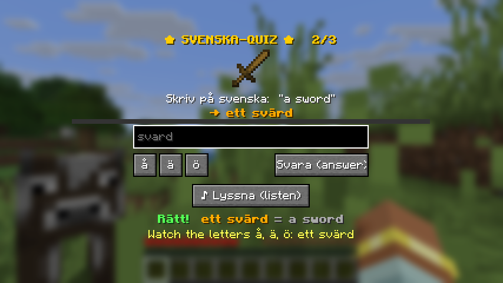
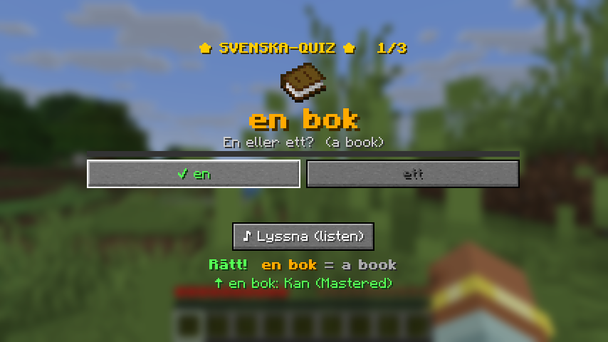
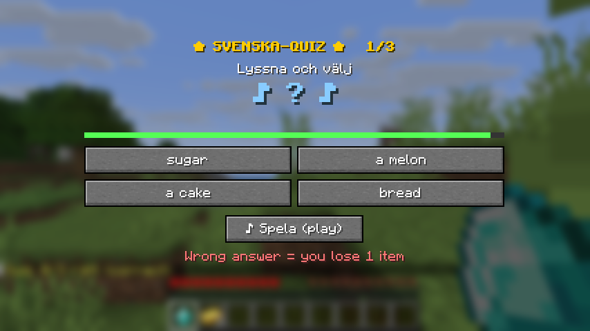
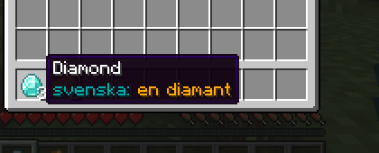
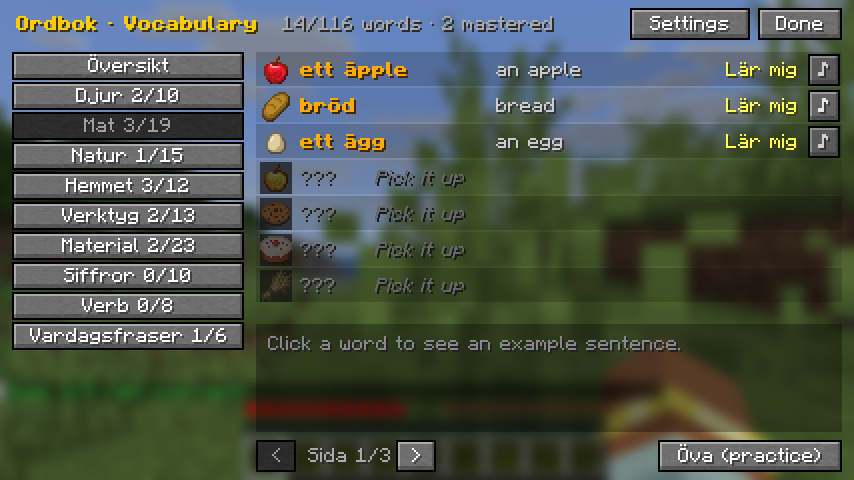
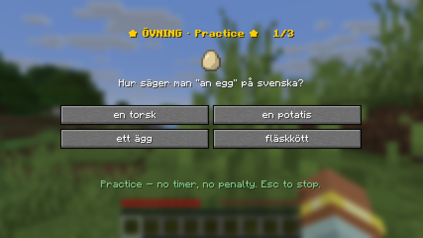


## Levels – for people who already know some Swedish

Pick your level in Settings (**Swedish level**). Changing it also sets a matching default for English translations, which you can still change.

| Level | For | What you get |
|---|---|---|
| **Beginner (A1)** | Complete beginners | Words with en/ett, pictures, English support. Questions get harder as words improve (see above) |
| **Intermediate (A2)** | You know basic words | **Grammar:** definite form (*en diamant → diamanten*), plural (*en bok → böcker*), present tense (*att gå → går*), ordinals (*tre → tredje*). **Gap sentences:** *Jag har ___!* with a picture so only one answer fits. English hidden until you click "Visa engelska" |
| **Advanced (B1+)** | You can read simple Swedish | **Swedish only.** Definitions instead of translations: *"Ett stort djur som ger mjölk." → en ko*. Past tense and supine (*äta → åt, ätit*). Most answers typed. New words show a Swedish definition, not English. Quiz buttons and hints in Swedish |

- **Unlock all words** (Intermediate and Advanced): skip discovering words you already know. All 116 words become available to quizzes and the journal at once. No milestone shields are given for it.
- **Good wrong answers:** the wrong options in grammar questions are the word's other forms (*diamanter* when asking for *diamanten*) and typical learner mistakes (*ätade* instead of *åt*).
- **Journal:** from Intermediate, each word shows its forms (*Former: diamanten · diamanter*); at Advanced, also its Swedish definition.

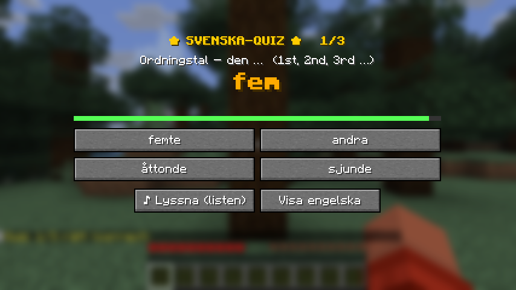
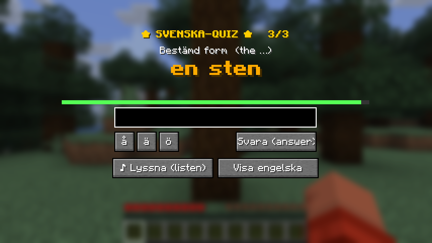
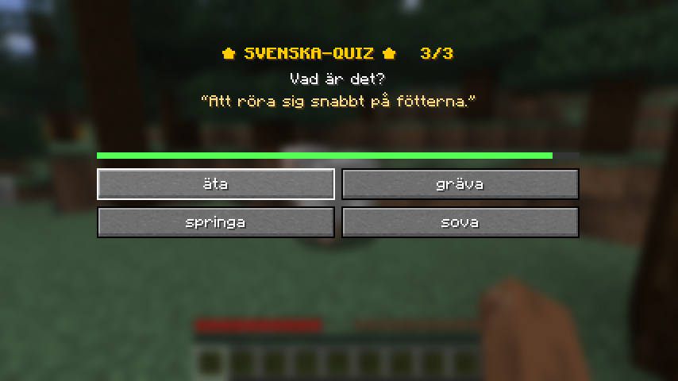
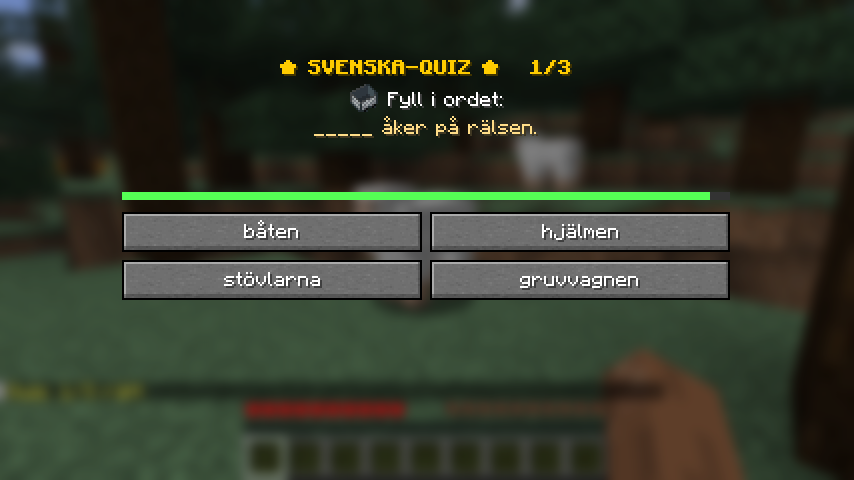
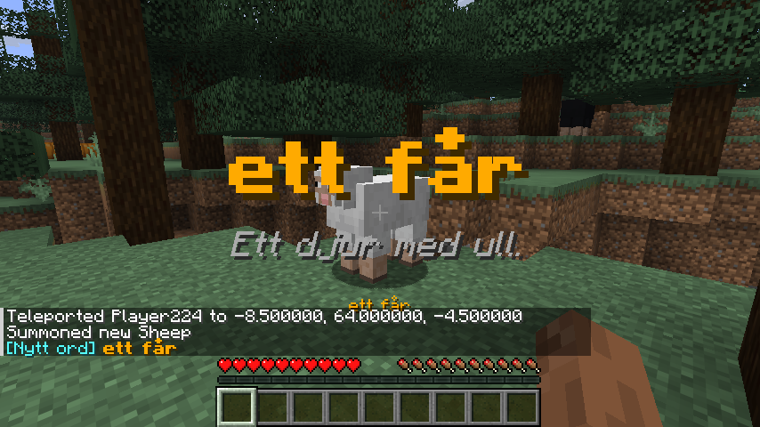
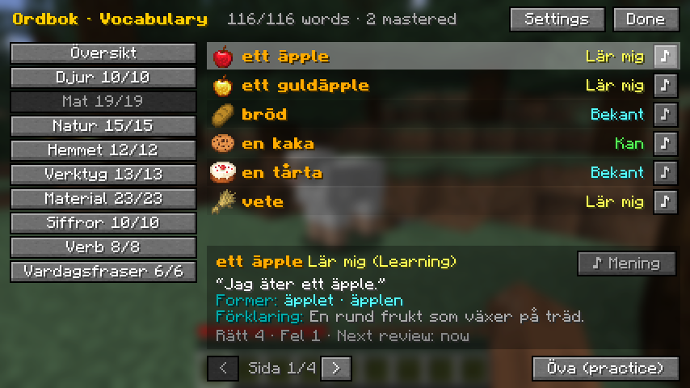

## Settings (Journal → Settings, or `/svenska settings`)


| Setting | Options |
|---|---|
| Swedish level | Beginner (A1) / Intermediate (A2) / Advanced (B1+) – see Levels above |
| Learning intensity | **Relaxed**: 1 question every 15 min, no reminders. **Balanced**: 2 questions every 10 min. **Immersive**: 3 questions every 5 min, frequent hotbar reminders |
| Translations | **Always** · **On demand**: English hidden until you click "Visa engelska", hover the chat line or select the word · **Never**: Swedish and pictures only; quizzes use pictures as answers |
| Voice | **Off** · **Discovery only**: a new word is spoken once, short reactions in quizzes, ♪ buttons · **Manual playback**: only when you press ♪ |
| Voice volume | 0–100% (Minecraft's Voice/Speech slider also applies) |
| Quiz penalty | **None** · **Small**: lose 1 item · **Survival**: lose a whole stack |
| Quiz every / answer time | Override the intensity's interval; 15–60 s per question (typing questions get double) |
| Daily goal | Off, 5, 10, 20 or 30 questions a day |
| Typing questions | Turn "type the word" questions on/off |
| Swedish in tooltips | Show the Swedish word in item tooltips |


### Audio design

- A word is spoken **once**, when you first find it. Picking it up again never triggers speech.
- Quiz audio is optional (♪ Lyssna). Reactions are short and varied (*Rätt! Snyggt! Precis! Bra! Perfekt!* / *Inte riktigt. Nästan. Hoppsan.*), never the same line twice in a row.
- A single voice channel: clips never overlap. ♪ replaces what's playing; new-word clips wait their turn.
- Everything else is subtle chimes, not speech.

## Install

1. Install [Fabric Loader](https://fabricmc.net/use/installer/) for Minecraft **26.3**.
2. Put [Fabric API](https://modrinth.com/mod/fabric-api) (26.3) and [`dist/svenskacraft-2.2.1+26.3.jar`](dist/svenskacraft-2.2.1+26.3.jar) in `.minecraft/mods`.

**Two Minecraft versions:** `svenskacraft-2.2.1+26.3.jar` for Minecraft **26.3** and `svenskacraft-2.2.1+26.2.jar` for **26.2** (same features). Use the one that matches your profile. The `SvenskaCraft-Lunar-…zip` files contain the same jars, for browsers that block `.jar` downloads.

**CurseForge app:** import [`dist/SvenskaCraft-CurseForge-2.2.1+26.3.zip`](dist/SvenskaCraft-CurseForge-2.2.1+26.3.zip): Minecraft → Create Custom Profile → Import → choose the zip. It sets up Minecraft 26.3 + Fabric with Fabric API and SvenskaCraft included; then press Play. (Rebuild it with `python3 tools/make_curseforge_pack.py <fabric-api.jar>`.)

**Lunar Client:** Lunar supports Minecraft 26.3 and custom Fabric mods, and already includes Fabric API. Pick version **26.3** with **Fabric** in the Lunar launcher, add `svenskacraft-2.2.1+26.3.jar` as a custom mod, and don't add Fabric API yourself.

**Upgrading:** 2.0 progress loads as-is. **From 1.0:** your learned words, points and settings are moved over automatically the first time you start the game. Old words are not spoken again.

## Commands

| Command | |
|---|---|
| `/svenska journal` (or **J**) | Open the journal |
| `/svenska settings` | Settings |
| `/svenska quiz` | Quiz now |
| `/svenska interval <minutes>` | Time between quizzes |
| `/svenska penalty on\|off` | Survival / no penalty |
| `/svenska on\|off` | Turn the mod on/off |
| `/svenska stats` | Progress summary |

## Saving

- **Location:**
  - `.minecraft/config/svenskacraft/settings.json`
  - `.minecraft/config/svenskacraft/progress-sv.json`
- **Shared progress:** it's shared by all worlds and servers. You're learning, not the world.
- **Safe writes:** files are written to a temp file and swapped in, with a `.bak` copy of the previous version. If a file is damaged, the backup is loaded.
- **When:** at most every 30 s, and when you leave a world or quit.

## Limitations

- **On servers, wrong answers throw items on the ground instead of deleting them.** A client mod can't delete items there because the server owns your inventory. Shields and "None" work everywhere.
- **Milestone rewards are shields and notifications, not items,** for the same reason.
- **Some discoveries are approximate:**
  - Animals need line of sight within 10 blocks.
  - "Bygga" (build) is detected when a held block stack shrinks while you hold right-click.
  - Numbers come from how many items you pick up at once; high numbers are rarer.
- **"Never" translations:** verbs and phrases have no clear picture, so their quiz shows the icon and asks for the Swedish word.
- **Typing:** answers are checked by spelling only; a synonym that's also correct Swedish is marked wrong.
- **Levels:** the grammar covers the 116 words in the mod: noun forms, 8 verbs, ordinals 1–10. There are no adjectives, word-order or longer-sentence exercises yet. Mass nouns (*jord, sand, guld*) have no plural question.
- **Interface at Advanced:** quiz text and the journal's word details are Swedish; menus and settings stay in English.
- **Daily goal:** uses your computer's date; changing the clock changes the day.
- **Short review gaps use real time,** so time offline also counts toward when a word is due.
- **Voice:** a synthetic voice (Piper NST, CC0). It was the clearest of the three Swedish Piper voices in a speech-recognition test, but it isn't a human recording.

## For developers

```bash
./gradlew build     # Java 25; runs unit tests → build/libs/svenskacraft-2.2.1+26.3.jar
./gradlew test      # unit tests only (vocabulary data, mastery, scheduler, question planner, answer checking, daily goal, saving, migration, milestones)
```

```
src/main/resources/assets/svenskacraft/
  vocab/categories.json      categories (id, icon, English name)
  vocab/concepts.json        language-neutral words: meaning, category, icon, how they're discovered
  languages/sv/pack.json     Swedish UI text, category names, voice reactions
  languages/sv/words.json    Swedish word, example sentence, grammar forms, definition per concept
  sounds/sv/...              generated voice clips
src/main/java/svenskacraft/
  vocab/ lang/               data loading
  learning/                  levels, word states, scheduler, question planner, grammar forms + gap sentences,
                             answer checking, daily goal, milestones (no Minecraft code, unit tested)
  progress/ settings/        saving, migration
  discovery/ audio/ ui/      in-game parts
```

**Add a word:**
1. Add an entry to `concepts.json` (`items`, `entities`, `events` or `amount`).
2. Add its Swedish text to `languages/sv/words.json`.
3. Regenerate the voice:

```bash
python3 tools/generate_voices.py sv sv-se-nst-medium.onnx
```

**Add a language:**
1. Create `languages/<code>/pack.json` and `words.json`.
2. Generate its clips with a Piper voice for that language.
3. Set `"language"` in `settings.json`.

Progress is saved per language.

Voice: Piper `sv-se-nst-medium` by KBLab / National Library of Sweden (CC0).
