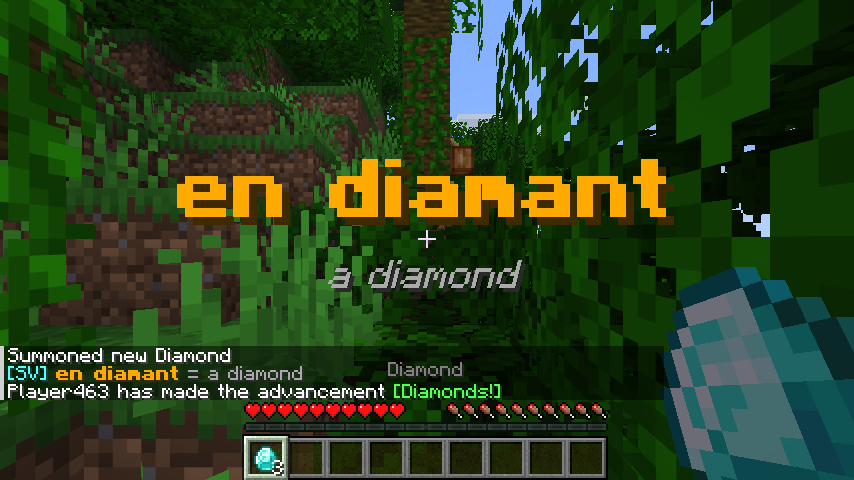
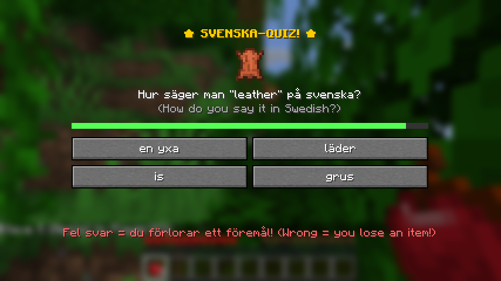
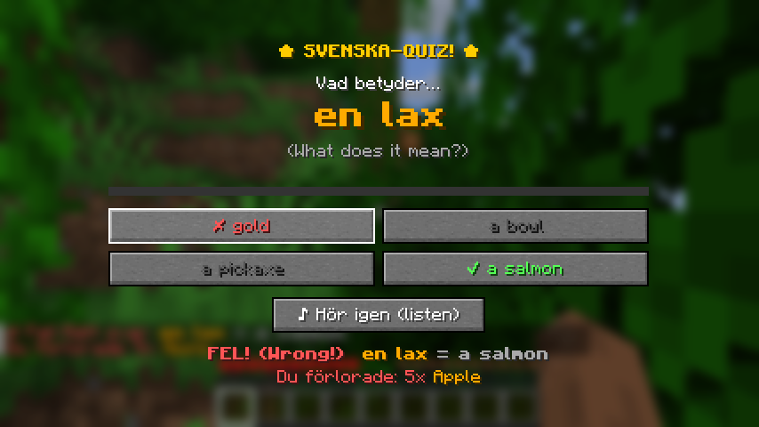

# SvenskaCraft – learn Swedish in Minecraft

Client-side Fabric mod for **Minecraft Java 26.3**. Only you install it; it works in singleplayer and on any server.

- **Pick up an item** → a Swedish voice says the word, the Swedish word appears big on screen with the English translation under it.
- **Every 10 minutes** → a quiz pops up (4 answers, 30 seconds). Two question types: "What does *en lax* mean?" (with voice) and "How do you say *a diamond* in Swedish?" (with the item's picture).
- **Wrong answer or time runs out** → a random stack disappears from your inventory.
- 82 words (blocks, food, tools, mob drops…), questions come from words you've already picked up.





## Install

1. Install [Fabric Loader](https://fabricmc.net/use/installer/) for Minecraft **26.3**.
2. Download [Fabric API](https://modrinth.com/mod/fabric-api) for 26.3.
3. Put `fabric-api-….jar` and [`dist/svenskacraft-1.0.0.jar`](dist/svenskacraft-1.0.0.jar) in your `.minecraft/mods` folder.
4. Start Minecraft with the Fabric profile.

## Commands

| Command | What it does |
|---|---|
| `/svenska quiz` | Quiz right now |
| `/svenska interval <minutes>` | Time between quizzes (default 10) |
| `/svenska penalty on\|off` | Lose an item on a wrong answer |
| `/svenska on\|off` | Turn the mod on/off |
| `/svenska words` | Words you've learned |
| `/svenska stats` | Points and streak |

Settings are saved in `.minecraft/config/svenskacraft.json` (also `answerSeconds`).

## Singleplayer vs servers

- **Singleplayer / LAN host:** the item is really deleted.
- **On a server:** a client mod can't delete items (the server owns your inventory), so the stack is **thrown on the ground** instead.

## Build / add words

```bash
./gradlew build          # needs Java 25 → build/libs/svenskacraft-1.0.0.jar
```

Words live in `src/main/resources/assets/svenskacraft/words.json`. After editing, regenerate the voice clips:

```bash
pip install piper-tts    # plus ffmpeg
python3 tools/generate_voices.py sv-se-nst-medium.onnx
```

Voice: Piper `sv-se-nst-medium` (KB-Lab / National Library of Sweden, CC0).
